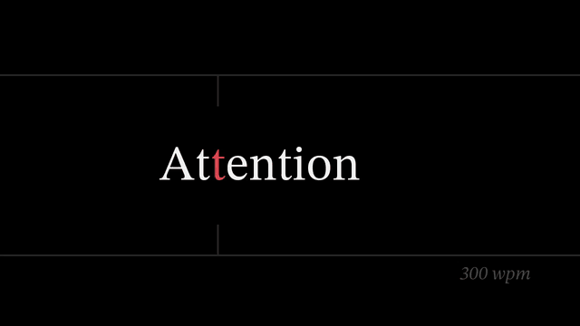

# Redline

**Turn any PDF into a speed-reading video.** Words flash one at a time with the fixation
letter in red, pinned to the same spot, so your eyes never move. Upload a paper, pick a speed
ramp (say 300 → 900 wpm), and download an MP4 in landscape, square or vertical format.

**[Try it in your browser](https://huggingface.co/spaces/astroanand/redline)**. Everything runs
client-side, so your PDF is never uploaded.



Redline comes in two builds that share one engine, checked against each other by tests:

- **Browser** (`web/`, the live demo): pdf.js reads the PDF, a canvas draws the frames and the
  browser's H.264 encoder (WebCodecs) writes the MP4. It is a static site with no server.
- **Python** (`redline/`): a command-line tool and a Gradio app, using pypdf, Pillow and ffmpeg.

## Why

Most reading time goes into moving your eyes: saccades between words and jumps back to reread.
RSVP (rapid serial visual presentation) removes those movements by showing each word in a fixed
spot. Redline does this for PDFs. It cleans up the extracted text first, so you get the paper's
prose instead of its page furniture, and then renders a shareable video.

## How it works

```
PDF ──► extract (pypdf) ──► clean ──► tokenize ──► schedule ──► draw frames ──► encode
                            │          │            │            │               │
          headers/footers,  │   pause multipliers   wpm ramp,    Pillow, ORP     ffmpeg concat,
          page numbers,     │   for . , ¶ and long  rounded on   letter centred   one PNG per
          hyphen rejoin,    │   words / numbers     running sum  on the tick      unique word
          refs + citations  ┘                       (no drift)
```

- **Optimal recognition point.** The red letter sits slightly left of centre (2nd letter of a
  5-letter word, 3rd of a 9-letter word, and so on). Every word is shifted so that letter lands
  on the tick marks.
- **Natural pacing.** Sentence ends get 2× time, commas 1.5×, paragraph breaks 2.5×. Long words
  and numbers get a little extra.
- **Text cleanup for papers.** Running headers and footers are removed (lines repeated on most
  pages), page numbers dropped, words split across lines rejoined, headings and paragraphs
  detected, and the references section, citations (`[12]`, `(Vaswani et al., 2017)`), links,
  emails and arXiv stamps stripped on request.
- **Fast encoding.** Each distinct (word, speed) frame is drawn once and reused, then ffmpeg's
  concat demuxer holds it for the right number of frames. Frame counts are rounded on the
  running total, so a 10-minute video stays in sync to within one frame. The 15-page
  *Attention Is All You Need* paper (4.7k words, a 12.5-minute video at 300 → 600 wpm)
  renders in about 20 s on a laptop.

## Run it locally

The browser build is plain static files:

```bash
python3 -m http.server 8000 -d web   # then open http://localhost:8000
```

The Python build:

```bash
uv venv && uv pip install -r requirements-dev.txt
.venv/bin/python app.py            # Gradio UI on http://127.0.0.1:7860
```

Or use the command line:

```bash
python -m redline paper.pdf -o paper.mp4 --start 300 --end 900 --format 1:1
python -m redline notes.txt -o notes.mp4 --start 450 --theme Light
python -m redline book.pdf -o ch1.mp4 --pages 12-30 --keep-references
```

## Project layout

| File | Role |
| --- | --- |
| `redline/extract.py` | PDF text extraction and cleanup heuristics |
| `redline/tokens.py` | Word tokens and pause multipliers |
| `redline/orp.py` | Fixation-letter (ORP) index |
| `redline/timing.py` | WPM ramps and drift-free frame counts |
| `redline/style.py`, `render.py` | Frame geometry and Pillow drawing |
| `redline/video.py` | ffmpeg encoding with progress |
| `redline/pipeline.py` | Text in, MP4 out |
| `app.py` | Gradio app (runs on a Gradio Space; needs a paid Hugging Face plan) |
| `web/js/engine/` | The same engine in JavaScript: cleanup, tokens, ORP, timing, layout |
| `web/js/pdftext.js` | pdf.js text extraction, rebuilt into lines |
| `web/js/render.js`, `player.js` | Canvas frame drawing and live playback |
| `web/js/export.js` | WebCodecs H.264 encoding into MP4 (mp4-muxer) |
| `web/js/app.js`, `web/index.html` | The static page (the Hugging Face Space) |
| `scripts/deploy_space.sh` | Publish `web/` as a static Space |

## Tests

```bash
.venv/bin/python -m pytest --cov   # Python engine, CLI and Gradio app
npm test                           # browser engine (node --test, no dependencies)
```

The 107 Python tests cover ORP placement (measured from red pixels in rendered frames), cleanup
heuristics, timing drift, every output format, the CLI, the Gradio handlers and the server-side
limits (speed range, text size, video length, PDF parse timeout). Coverage is 96%.

The 19 JavaScript tests hold the browser engine to the Python one. `tests/web/make_fixtures.py`
records the Python answers (fixation letters, tokens and pauses, wpm ramps, frame counts,
layouts, PDF cleanup) and the browser engine must match them exactly. A pytest check fails if
the fixtures go stale. In a real browser, the full *Attention Is All You Need* paper reads in
about 0.2 s and exports a frame-exact 12.6-minute MP4 in about 20 s.

## Limits

- Scanned PDFs have no text layer, so run OCR first.
- Math, tables and figure captions come through as plain text.
- Comprehension drops at very high speeds. RSVP works best for skimming, review and practice.

## Credits

The frame style follows the classic RSVP speed-reading look: black background, serif word,
red fixation letter, guide ticks. Font: [STIX Two Text](https://github.com/stipub/stixfonts)
(SIL OFL 1.1). Sample PDF: the Gettysburg Address (public domain). The browser build vendors
[pdf.js](https://github.com/mozilla/pdf.js) 6.5.438 (Apache-2.0) and
[mp4-muxer](https://github.com/Vanilagy/mp4-muxer) 5.2.2 (MIT) in `web/vendor/`, with their licences.
